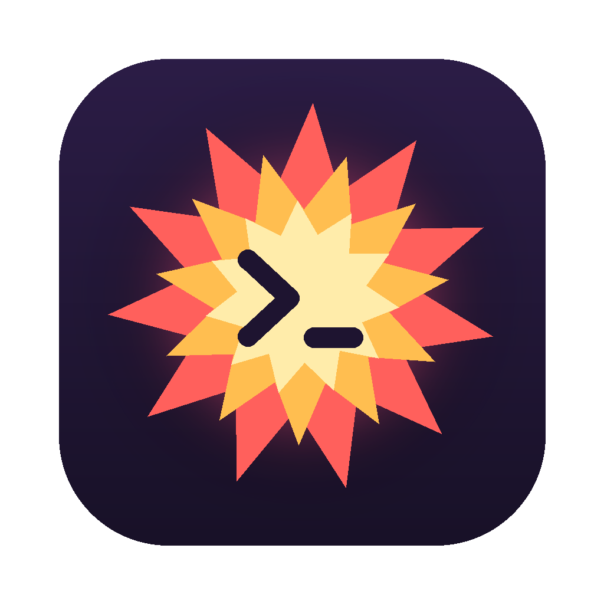

<p align="center">
  
</p>

<h1 align="center">Oopsie</h1>

<p align="center"><strong>Break Linux. Not your Mac.</strong></p>

<p align="center">
  <a href="LICENSE"></a>
  <a href="https://github.com/Mostafa-Davoodi/Oopsie/actions/workflows/ci.yml"></a>
</p>

Oopsie is a small macOS menu bar app for throwaway Ubuntu machines. Click once to get a fresh Linux machine. SSH into it, share a folder with it, break it, and remove it. Your Mac is never at risk.

Each machine is a lightweight VM made by Apple's [`container`](https://github.com/apple/container) tool. Oopsie is a simple, native menu on top of that tool.

```
Oopsie
2 machines · 1 running
──────────────────────────────
MACHINES
● oopsie-1a2b                ▸   SSH in Terminal
  Running · 192.168.64.3         Copy SSH Command
● oopsie-77f0                ▸   Copy IP Address
  Stopped                        Open Root Shell
──────────────────────────────   ───────────────
+ New Machine                    Open Shared Folder
  New Machine with Folder…       ───────────────
──────────────────────────────   Stop
Quit Oopsie                      ───────────────
                                 Remove
```

## Features

- **One-click Linux.** A new Ubuntu machine is ready in about 15 seconds.
- **Real SSH.** Each machine runs an SSH server and has its own IP address. Use Terminal, VS Code, scp or any SSH tool.
- **Shared folders.** Mount a Mac folder into a machine. Edit on your Mac, run in Linux.
- **Many machines.** Each machine has its own line in the menu, with its actions in a submenu.
- **Notifications.** macOS tells you when a machine is ready. Click the notification to SSH in.
- **Small and native.** A plain macOS menu. No windows, no Dock icon, no settings.

## Requirements

| | |
| --- | --- |
| Mac | Apple silicon (M1 or later) |
| macOS | 15 or later. 26 or later is recommended, because macOS 15 has networking limits. |
| Apple's `container` tool | Homebrew installs it for you. Or get it from [its releases page](https://github.com/apple/container/releases). |
| To build from source | Xcode 16 or later (or its command line tools) |

## Install with Homebrew

```bash
brew install --cask mostafa-davoodi/oopsie/oopsie
```

This command also installs Apple's `container` tool. Then open **Oopsie** from your Applications folder.

> **First open:** if the release is not notarized, macOS blocks the app. Go to **System Settings → Privacy & Security** and click **Open Anyway**. You only do this once.

## Set up from source

1. Install Apple's `container` tool:

   ```bash
   brew install container
   ```

   You do not need to start the container engine. Oopsie starts it when you make the first machine.

2. Get the code:

   ```bash
   git clone https://github.com/Mostafa-Davoodi/Oopsie.git
   cd Oopsie
   ```

3. Build and install the app:

   ```bash
   ./make-app.sh --install
   ```

   This builds `build/Oopsie.app`, copies it to `/Applications`, and opens it. To build without installing, run `./make-app.sh`.

## Use

1. Click the starburst icon in the menu bar, then click **New Machine**.
   The first machine downloads Ubuntu (about 30 MB) one time.
2. Wait for the notification "oopsie-xxxx is ready". The menu also shows the machine's IP address instead of "Setting up SSH…".
3. Click the notification, or open the machine's submenu and click **SSH in Terminal**.

The menu bar icon shows if a machine is running:

| No machine running | At least one machine running |
| :---: | :---: |
| <picture><source media="(prefers-color-scheme: dark)" srcset="docs/images/menubar-idle-dark.svg"></picture> | <picture><source media="(prefers-color-scheme: dark)" srcset="docs/images/menubar-running-dark.svg"></picture> |

### SSH from your own tools

Click **Copy SSH Command**, or run:

```bash
ssh -i ~/.ssh/oopsie_ed25519 root@<ip>
```

Oopsie makes the key `~/.ssh/oopsie_ed25519` the first time you make a machine. It also adds your own `~/.ssh/id_*.pub` keys to each new machine, so `ssh root@<ip>` works with your normal key too. Password login is off. Only your Mac can reach the machines.

### Shared folders

Click **New Machine with Folder…** and choose a folder on your Mac. The folder shows up in the machine as `/root/<folder name>`. Changes go both ways. **Open Shared Folder** in the machine's submenu opens the folder in Finder.

- You can share a folder only when you make a machine.
- Removing the machine does not change the folder on your Mac.
- Files that the machine writes in the folder belong to root.

### Machine actions

| Action | What it does |
| --- | --- |
| SSH in Terminal | Opens a Terminal window with SSH to the machine. |
| Copy SSH Command | Copies the full `ssh` command. |
| Copy IP Address | Copies the machine's IP address. |
| Open Root Shell | Opens a root shell without SSH. Works even if the SSH setup fails. |
| Open Shared Folder | Opens the shared Mac folder in Finder. |
| Stop / Start | Stops or starts the machine. Its files stay. |
| Remove | Deletes the machine and everything in it. There is no confirmation. |

Machines keep running when you quit Oopsie, and they show again when you open it.

## Troubleshooting

| Problem | What to do |
| --- | --- |
| The menu says "Apple's container tool is not installed". | Run `brew install container`. |
| The menu says "Container engine is stopped". | Click **Start Engine**, or run `container system start`. |
| A machine shows "Running · SSH unavailable". | Click **Open Root Shell**, then run `cat /var/log/oopsie-setup.log`. The setup needs internet access to install the SSH server. |
| SSH does not connect. | Run `ping <ip>`. If it fails, run `container system stop` and then `container system start`. |
| No notifications. | Allow notifications for Oopsie in **System Settings → Notifications**. Notifications only work in the built app, not with `swift run`. |
| An action fails. | The error shows at the top of the menu. Click it to copy the full message. |

To see all machines from the command line, run `container list --all`.

## Uninstall

1. Remove the machines with **Remove** in the menu (or `container delete --force <name>`).
2. Remove the app:

   ```bash
   brew uninstall --cask oopsie        # if you installed with Homebrew
   rm -rf /Applications/Oopsie.app     # if you built from source
   ```

3. Optional: delete Oopsie's SSH key with `rm ~/.ssh/oopsie_ed25519 ~/.ssh/oopsie_ed25519.pub`.

## Development

Run the app from the terminal:

```bash
swift run
```

Or open the project in Xcode:

```bash
open Package.swift
```

Then choose the **Oopsie** scheme and **My Mac**, and press ⌘R.

Run the tests:

```bash
swift test
```

To try the menu without Apple's `container` tool or real machines, use the fake script in this repo:

```bash
OOPSIE_CONTAINER="$PWD/scripts/fake-container" swift run
```

It shows one running and one stopped machine. The actions do nothing.

### Project layout

```
Package.swift            Swift package (no dependencies)
Sources/Oopsie/
  OopsieApp.swift        app entry point
  MenuController.swift   the menu bar icon and its native menu
  OopsieStore.swift      machine list, polling, actions and shared folders
  ContainerCLI.swift     talks to Apple's `container`, plus the machine setup script
  SSH.swift              Oopsie's SSH key and Terminal windows
  Notifier.swift         "machine is ready" notifications
Tests/OopsieTests/       unit tests (run with `swift test`)
Resources/
  Info.plist             app bundle settings and version
  AppIcon.png            app icon
docs/images/             menu bar icons for this README
make-app.sh              builds Oopsie.app
scripts/
  release.sh             release zip and Homebrew cask
  fake-container         stand-in `container` CLI for development
.github/workflows/
  ci.yml                 builds and tests every push and pull request
  release.yml            makes a GitHub release from a version tag
```

### How it works

| Action | Under the hood |
| --- | --- |
| New Machine | `container run --detach --name oopsie-xxxx --env OOPSIE_KEYS=… ubuntu:latest sh -c <setup>` |
| Shared folder | adds `--volume <mac folder>:/root/<name>` |
| List | `container list --all --format json`, every few seconds |
| SSH | `ssh root@<machine ip>` in a new Terminal window |
| Open Root Shell | `container exec --interactive --tty oopsie-xxxx bash` |
| Stop / Start | `container stop` / `container start` |
| Remove | `container delete --force oopsie-xxxx` |

The machine's main process installs `openssh-server` (only the first time), adds the SSH keys, starts `sshd`, and then waits. It runs again on every start, so SSH also works after a stop and start.

## Release

```bash
scripts/release.sh            # builds build/Oopsie-<version>.zip and build/oopsie.rb
scripts/release.sh --publish  # also makes the GitHub release and updates the Homebrew tap
```

1. Change `CFBundleShortVersionString` in `Resources/Info.plist`.
2. Commit your changes.
3. Run `scripts/release.sh --publish`.

`--publish` needs `gh` to be logged in as the repo owner (`gh auth switch --user Mostafa-Davoodi`). It also needs the GitHub repo `Mostafa-Davoodi/Oopsie` and the tap repo `Mostafa-Davoodi/homebrew-oopsie`. Set `REPO` and `TAP` to use other repos.

To sign and notarize the app, set `DEVELOPER_ID` (a "Developer ID Application" certificate) and `NOTARY_PROFILE` (from `xcrun notarytool store-credentials`). Without them, the app is only ad-hoc signed, and macOS blocks it on first open.

Or let GitHub Actions make the release: push a tag that matches the version, for example `git tag v0.2.0 && git push origin v0.2.0`. The release workflow tests, builds and uploads the zip. It also updates the Homebrew tap if the repo has a `TAP_GITHUB_TOKEN` secret (a fine-grained token that can write to the tap repo). If the release already exists, the workflow does nothing.

## Contributing

Bug reports, ideas and pull requests are welcome. Read [CONTRIBUTING.md](CONTRIBUTING.md) first. Every commit needs a `Signed-off-by` line (`git commit -s`). Everyone in the project follows the [Code of Conduct](CODE_OF_CONDUCT.md).

To report a security problem, do not open an issue. Follow [SECURITY.md](SECURITY.md).

## License

Oopsie is licensed under the [Apache License 2.0](LICENSE). See [NOTICE](NOTICE).

Apple's `container` tool is a separate project with its own license. Oopsie runs it but does not include it.
